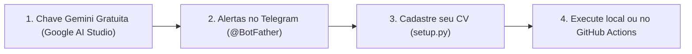

# 📚 Tutorial Passo a Passo: Configurando seu Caçador de Vagas com IA

Este guia ensina como qualquer candidato ou desenvolvedor pode clonar este repositório, cadastrar seu próprio currículo e receber alertas diários das melhores vagas de emprego (Júnior, Estágio ou Trainee) diretamente no **Telegram** ou **WhatsApp**, avaliadas pela **IA do Google Gemini**, sem gastar **nenhum centavo**!

---

## 🧭 Visão Geral em 4 Etapas



---

## 🔑 Etapa 1: Obter sua chave gratuita da Gemini API

A inteligência artificial que lê as descrições das vagas e avalia a compatibilidade com seu perfil é fornecida pela Google Gemini API.

> [!NOTE]
> O Google disponibiliza uma cota generosa de uso **100% gratuito** para desenvolvedores via Google AI Studio. Você não precisa cadastrar cartão de crédito.

1. Acesse: [https://aistudio.google.com/app/apikey](https://aistudio.google.com/app/apikey)
2. Faça login com sua conta do Google (Gmail).
3. Clique no botão azul **"Create API key"** (Criar chave de API).
4. Selecione ou crie um projeto padrão do Google Cloud e clique em **"Create API key in existing project"**.
5. Copie a chave gerada (ela começa com `AIzaSy...`). Guarde-a com segurança!

---

## 📱 Etapa 2: Configurar Alertas no Telegram (2 minutos)

O bot envia um resumo completo das vagas diretamente para o seu Telegram.

1. **Criar seu Robô no Telegram:**
   - Abra o Telegram e pesquise por `@BotFather`.
   - Envie o comando `/newbot`.
   - Escolha um nome para o bot (ex: `Meu Cacador de Vagas`).
   - Escolha um username que termine em `bot` (ex: `meu_cacador_vagas_bot`).
   - O `@BotFather` enviará uma mensagem contendo seu **HTTP API TOKEN** (algo como `7123456789:AAFnk...`). Copie esse token (`TELEGRAM_BOT_TOKEN`).

2. **Descobrir o seu Chat ID:**
   - No Telegram, abra a conversa com o seu próprio bot que acabou de criar e envie qualquer mensagem (ex: "Oi").
   - Em seguida, procure pelo bot `@userinfobot` no Telegram e clique em **Começar** (Start).
   - Ele responderá com o seu **Id** numérico (ex: `123456789`). Copie esse número (`TELEGRAM_CHAT_ID`).

---

## 🧙 Etapa 3: Instalação e Assistente Automático (`setup.py`)

1. **Clone o repositório:**
   ```bash
   git clone https://github.com/Luizrocha0/bot-vagas.git
   cd bot-vagas
   ```

2. **Crie um ambiente virtual e instale as dependências:**
   ```bash
   python -m venv venv
   
   # No Windows:
   .\venv\Scripts\activate
   
   # No Linux/Mac:
   source venv/bin/activate
   
   pip install -r requirements.txt
   ```

3. **Execute o assistente interativo de configuração:**
   ```bash
   python setup.py
   ```
   O assistente irá:
   - Solicitar sua `GEMINI_API_KEY` e testar a conexão na hora com o Google AI Studio.
   - Solicitar seu `TELEGRAM_BOT_TOKEN` e `TELEGRAM_CHAT_ID`.
   - Gerar com segurança o seu arquivo `.env` local.
   - Perguntar seu Nome, Cidade/Estado, Cargos Desejados e Stack Técnica, gerando automaticamente seu arquivo `perfil_candidato.json`!

4. **Verifique se tudo está 100% OK:**
   ```bash
   python setup.py --check
   ```

---

## 📝 Etapa 4: Personalizando o seu Currículo (`perfil_candidato.json`)

Você pode abrir o arquivo `perfil_candidato.json` em qualquer editor de código (como VS Code) para adicionar seus projetos, formação e palavras-chave.

O arquivo segue a estrutura:
```json
{
  "nome": "Seu Nome Completo",
  "titulo": "Desenvolvedor(a) Full Stack Júnior | React · Node.js",
  "localizacao": "Sua Cidade, UF - Brasil",
  "formacao": {
    "instituicao": "Sua Faculdade",
    "curso": "Engenharia de Software / ADS / Ciência da Computação",
    "previsao_conclusao": "2027"
  },
  "preferencias_busca": {
    "cargos_alvo": [
      "Desenvolvedor Junior",
      "Estagio TI",
      "Desenvolvedor Front-end"
    ],
    "niveis": ["Estágio", "Júnior", "Trainee"],
    "palavras_chave": ["React", "TypeScript", "Node.js", "Python"]
  }
}
```

> [!TIP]
> Caso queira começar do zero com um exemplo pré-configurado, use o template pronto:
> ```bash
> python setup.py --init-cv
> ```

---

## 🚀 Etapa 5: Executando o Robô

### Execução de Demonstração (Rápida):
Para buscar 1 vaga remota e 1 vaga presencial nas fontes ativas:
```bash
python run.py --remotas 1 --presenciais 1 --paginas 1
```

### Escolhendo as Plataformas de Vagas:
Você pode escolher de onde deseja minerar vagas usando a flag `--fontes`:
```bash
# Buscar apenas na Gupy e no Programathor:
python run.py --fontes gupy,programathor

# Buscar em todas as plataformas (LinkedIn, Gupy, Programathor, Indeed):
python run.py --fontes linkedin,gupy,programathor,indeed
```

### Agendamento Contínuo Local:
Para deixar o robô rodando diariamente no seu computador nos horários de pico (09:00, 14:00 e 19:00):
```bash
python scheduler.py
```

---

## ☁️ Etapa 6: Automação 100% Gratuita no GitHub Actions

Não quer deixar seu computador ligado? O GitHub Actions roda o robô na nuvem para você gratuitamente todos os dias!

1. Faça um **Fork** deste repositório para a sua conta do GitHub ou crie um repositório próprio.
2. No seu repositório no GitHub, acesse **Settings** ⚙️ > **Secrets and variables** > **Actions**.
3. Clique em **"New repository secret"** e cadastre as chaves:
   - `GEMINI_API_KEY`: Sua chave do Google AI Studio.
   - `TELEGRAM_BOT_TOKEN`: Token do seu bot do Telegram.
   - `TELEGRAM_CHAT_ID`: Seu ID numérico do Telegram.
   - *(Opcional)* `WHATSAPP_PHONE` e `WHATSAPP_APIKEY` (se utilizar WhatsApp).
4. Habilite a permissão de gravação para o bot salvar as vagas já vistas:
   - Em **Settings** > **Actions** > **General** > **Workflow permissions**.
   - Marque a opção: **"Read and write permissions"** e salve.
5. Pronto! O workflow [`.github/workflows/job_hunter.yml`](.github/workflows/job_hunter.yml) executará automaticamente todos os dias às 09:00, 14:00 e 19:00 (horário de Brasília).

---

## ❓ Perguntas Frequentes (FAQ)

### 1. O robô consome minha cota da API paga do Gemini?
Não! O bot utiliza os modelos da linha Flash (`gemini-3.1-flash-lite`, `gemini-3.5-flash`), que possuem plano gratuito generoso no Google AI Studio, sem custos.

### 2. Como o bot evita me mandar a mesma vaga duas vezes?
Ele mantém um arquivo local `vagas_vistas.json`. Antes de enviar qualquer notificação, ele verifica se o ID da vaga já foi notificado anteriormente.

### 3. Posso rodar a suíte de testes para conferir se o código está integro?
Sim! Basta rodar:
```bash
pytest
```
São mais de 260 testes automatizados cobrindo scrapers, parsers, persistência, resiliência da IA e algoritmos de balanceamento de cotas.
